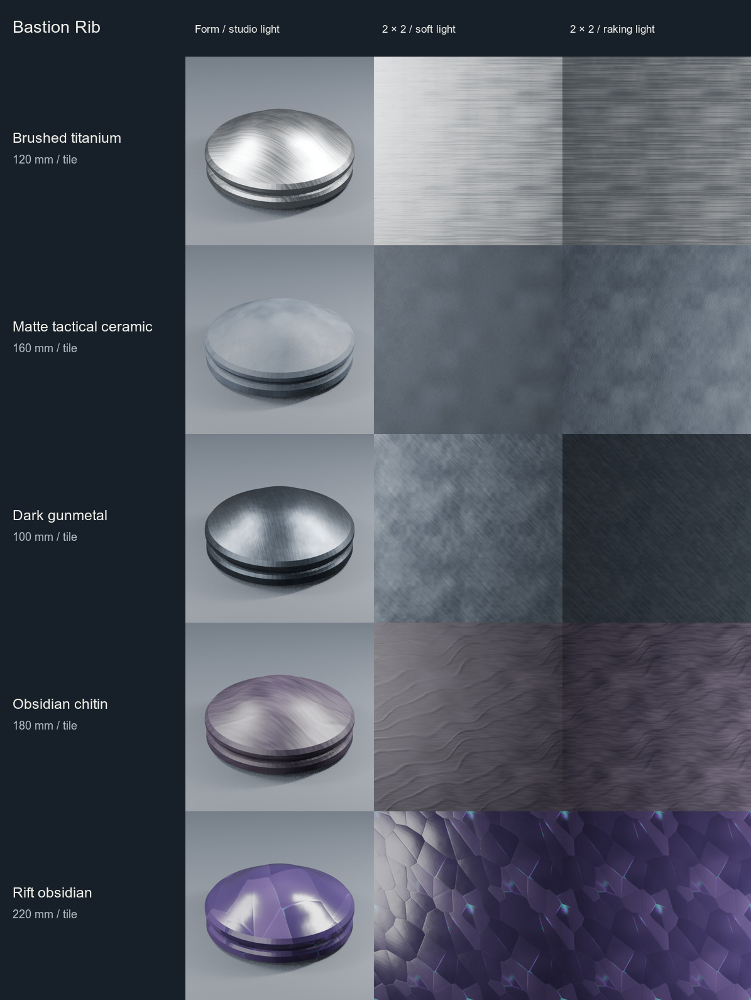

# Bastion Rib surface library

Five original finishes for the approved Bastion Rib kit. The editable Blender library and its portable textures are staged for Phase 3. The coupon sheet shows all five finishes on the same geometry and uses two light angles to expose seams at repeat boundaries.



| Surface ID | One UV tile | Texels/m | Authoring direction | Full-size coupon and 2×2 comparisons |
| --- | ---: | ---: | --- | --- |
| `brushed-titanium` | 120 mm | 2,133 | Satin silver ribs. Align U along each machined rib. Fine longitudinal brush cuts broaden the reflection. | [Titanium](review/brushed-titanium.webp) |
| `tactical-ceramic` | 160 mm | 1,600 | Graphite-blue armor with a sintered, dielectric finish. Broad faces show subtle firing variation and pores. | [Ceramic](review/tactical-ceramic.webp) |
| `dark-gunmetal` | 100 mm | 2,560 | Darkened machined metal. Burnished regions interrupt the oxide film and diagonal finishing marks. | [Gunmetal](review/dark-gunmetal.webp) |
| `obsidian-chitin` | 180 mm | 1,422 | Dark, warm-violet shell. Shallow curved growth ribs and finer trailing fibers follow the plate. | [Chitin](review/obsidian-chitin.webp) |
| `rift-obsidian` | 220 mm | 1,164 | Violet glassy mineral. Fractured faces change grazing reflections. Sparse inclusions emit teal and violet. | [Rift obsidian](review/rift-obsidian.webp) |

## Use in a generator

Import `material` and `SURFACES` from [the Blender module](../../blender/materials.py) with the repository's `blender/` directory on the generator's Python path. For example, `mesh.data.materials.append(material("brushed-titanium"))` binds the shared material. Set the active UV map to UV0 and divide the unwrapped distances in metres by `SURFACES[surface_id].tile_m`. A 0.24 m long titanium face spans two repeats along U. Use consistent UV direction across adjacent faces. Keep individual contact-edge wear, luminous class markings and damage masks in the piece-level bake.

The Asset Browser can also append materials from [bastion-materials.blend](bastion-materials.blend). Keep its five sibling image folders beside it. Each shader uses a repeated RGB8 sRGB base color, a linear OpenGL tangent-space normal (+Y) and linear ORM. R stores ambient occlusion, G roughness and B metallic. The red channel routes to Blender's glTF Material Output node. Rift obsidian also binds its own sRGB emissive map. Black emissive texels contribute zero light. PNG rows and staged glTF KTX2 payloads use top-left image order.

## Rebuild and verify

From the repository root, rebuild into a fresh staging directory. The procedural source defines all relief in metres, samples periodic fields, and differentiates wrapped neighbors. Cycles bakes EMIT in scene-linear color and tangent NORMAL on a fixed, triangulated UV plane. Each bake is compared against its source before writing 8-bit PNG. The pinned KTX encoder then produces UASTC/Zstandard textures with nine mip levels.

```sh
BLENDER=/Applications/Blender.app/Contents/MacOS/Blender
stage=$(mktemp -d)
"$BLENDER" -b -t 2 --factory-startup --python-exit-code 1 -P blender/build_materials.py -- --out "$stage"
python3 blender/package_materials.py --out "$stage"
python3 scripts/validate_glbs.py --manifest "$stage/manifest.json"
"$BLENDER" -b -t 2 --factory-startup --python-exit-code 1 -P blender/verify_materials.py -- --out "$stage" --metrics "$stage/quality.json"
cmp assets-source/materials/maps.json "$stage/maps.json"
cmp assets-source/materials/manifest.json "$stage/manifest.json"
cmp assets-source/materials/quality.json "$stage/quality.json"
```

For review images, run `"$BLENDER" -b -t 2 --factory-startup --python-exit-code 1 -P blender/review_materials.py -- --out "$stage"` on a booked EEVEE-capable Mac. Blender 5.2.2 LTS uses 12 temporal samples per 512 × 512 frame. ImageMagick 7 assembles the sheet and the five lossless WebP strips. The optional `--font` argument selects a TrueType font for the overview. Each strip retains both 2×2 planar comparisons at one rendered pixel per source texel.

A clean rebuild reproduced the 16 PNGs, 16 KTX2s, map measurements and manifest byte-for-byte. Blender archives contain session-dependent bytes. Both archives passed the same source-image, relative-path, color-space and GLB export/re-import checks. The scratch export retained all 16 PNGs by SHA-256, with both occlusion and metallic/roughness pointing to the same packed image for each surface.

The source PNGs have identical opposite rows, columns and corners. Across the decoded KTX2s, the largest channel RMSE was 1.677 levels on the 0–255 scale. The largest 95th-percentile difference between opposite edges was 6 levels. One rift emissive texel differed by 16 levels across an edge after compression. Decoded tangent normals ranged from 0.99483 to 1.00743 in length. The 16 encoded textures total 465,162 bytes. Asset-specific UV placement, final game shading, play-distance inspection, Quest acceptance and owner's visual sign-off occur at later project checkpoints.

[Authorship and source hashes](provenance.json) · [Baked map hashes, ranges and channel probes](maps.json) · [Compressed texture inventory](manifest.json) · [Decoded measurements](quality.json) · [Art direction](../../docs/art-bible.md)
