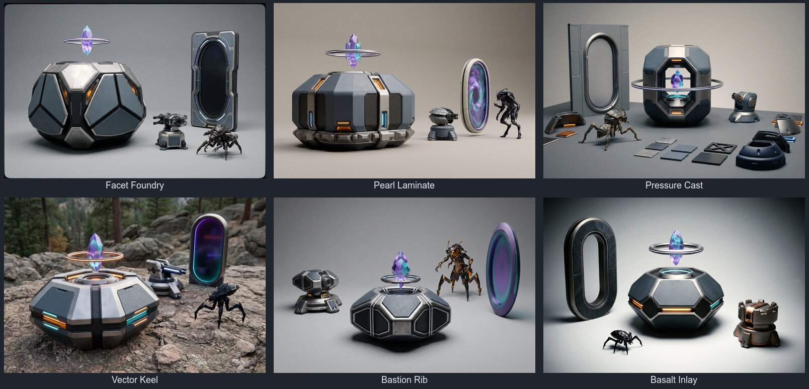
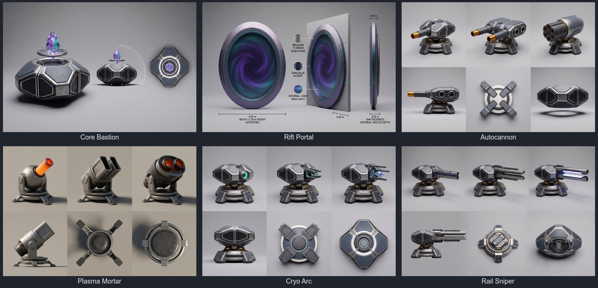
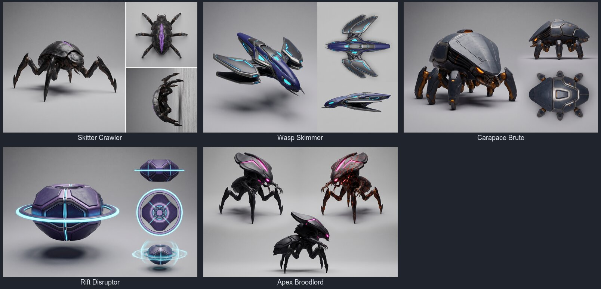

# Rift Bastion art bible

**Owner checkpoint 1 · awaiting Paul’s review.** Review the selected board, material direction and eleven linked sheets as one package. Approval covers the art direction used for subsequent Blender work. The PNGs are immutable illustration sources. The numeric contracts below govern the eventual meshes and pivots.

## Working direction

[Bastion Rib, full-size reference](../assets-source/concepts/boards/bastion-rib.png) gives the defenders a distinct edge at tabletop scale. Silver ribs wrap broad dark panels, so the crystal, armor planes and separate belly remain identifiable in a small preview. Its violet-teal portal keeps a continuous active oval. Use this board for material and lighting decisions. The individual sheets define the intended cast.

| Original board | Visual review |
| --- | --- |
| [Facet Foundry](../assets-source/concepts/boards/facet-foundry.png) | The large ceramic faces read cleanly. The dark pill-shaped opening loses the active rift. |
| [Pearl Laminate](../assets-source/concepts/boards/pearl-laminate.png) | Warm side light reveals the shingled pedestal. Its tall biped and heavy lower plinth weaken the insectoid and compact silhouettes. |
| [Pressure Cast](../assets-source/concepts/boards/pressure-cast.png) | Useful separated material coupons. The cage around the crystal competes with the portal’s silhouette. |
| [Vector Keel](../assets-source/concepts/boards/vector-keel.png) | The low wedge and continuous emitter strip hold up against busy rock. The outdoor surface makes relative material values harder to compare. |
| [Bastion Rib](../assets-source/concepts/boards/bastion-rib.png) | Working selection. A bright structural edge makes the dark ceramic panels legible, and the compact turret, crystal and oval portal have distinct contours. |
| [Basalt Inlay](../assets-source/concepts/boards/basalt-inlay.png) | The flat facets create a strong profile. Its dormant portal and castle-like bronze turret diverge from the powered military kit. |

### Concept sheets for review

The entries below link directly to each full-resolution original.

## Surface finish and light

Defender hardware has broad ceramic shields over a recessed carbon chassis. A brushed-metal rim catches the key light on the outside corners. Use a consistent grain direction along each machined panel, with wear limited to contact edges and clamp feet. Leave dark material between adjacent emitters so their shapes survive passthrough against a bright room. Invaders reverse that rhythm. Overlapping chitin grows outward from a continuous spine, with narrow luminous tissue at the joints. Avoid a rectangular hardware panel grid on living shells.

Linear roughness and metallic values below are proposed authoring ranges. Choose the finish by material region. Layer exposed metal beneath a chipped dielectric coating using its own mask.

| Surface | Roughness | Metallic | Visible use |
| --- | ---: | ---: | --- |
| Brushed titanium | 0.25–0.42 | 0.85–1.00 | Bevels, collars and outward faces of ribs. Directional satin highlight. |
| Matte tactical ceramic | 0.52–0.76 | 0.00–0.05 | Quiet, broad armor planes, with the rim defining the edge. |
| Carbon composite | 0.40–0.62 | 0.00–0.08 | Recessed support and underside. Keep the weave below silhouette scale. |
| Dark gunmetal | 0.28–0.48 | 0.75–1.00 | Rotating joints and clamp pivots; localized contact polish. |
| Obsidian chitin | 0.32–0.53 | 0.00–0.12 | Convex plates with narrow grazing reflections over rough inter-plate tissue. |
| Rift obsidian / crystal | 0.14–0.30 | 0.00–0.10 | Faceted crystal and inner bezel insert; glow belongs to the emissive mask. |

Bake base color and emissive as sRGB. Keep the tangent normal and packed ORM linear. ORM stores occlusion in red, roughness in green and metallic in blue. Reserve cobalt-white for the rail’s thin hot center, orange for plasma chamber mouths, amber for kinetic vents, and cyan for cryo coils. The common cryo-slow overlay is #22d3ee. Turret disruption uses a separate #38bdf8 halo. Leave both as state-driven overlays.

## Core and rift

[Core Bastion](../assets-source/concepts/sheets/core-bastion.png) · Eight-sided base, radius **0.38 m**, total height **0.72 m**, collision-free placement radius **0.55 m**. The tapered pedestal is 0.4032 m tall with a 0.3116 m top radius. The crystal has radius 0.15 m and sits at y = 0.57 m. Keep the crystal and containment collar independent. Cyan #2de2ff and violet #8b5cf6 identify the core. Its translucent hit shield and ground ring extend to radius **0.52 m**. Model budget is 14,000 triangles with 2048 px maps.

[Dimensional Rift Portal](../assets-source/concepts/sheets/rift-portal.png) · The nominal ellipse is **0.95 × 1.35 m** in local XY, rim thickness **0.12 m** and visual recess depth **0.45 m**. Aim local +Z along the host wall or ceiling normal. The blockout places the interior surface at z = −0.025 m and the inner ring at −0.015 m. Align the aperture mask and bezel on the same anchor and preserve the uninterrupted ellipse at oblique sightlines. Teal vortices sit inside a #7c3aed opening with a #6d28d9 rim. Portal keep-out radius is 0.65 m, minimum separation from the Core is 2.0 m. Rim budget is 4,500 triangles with 1024 px maps. Treat the generated callouts as illustrative. The thin side view places a single measurement under two captions. Use the art bible values above for rim thickness and visual recess depth.

## Turrets and mount interfaces

Use meters in exported game coordinates. The root origin is the center of the attachment plane. +Y points up from that plane and +Z points forward for a turret at neutral aim. All tiers have a **0.16 m footprint radius**. The four-legged surface clamp is 0.055 m high, with a 0.11 m ring radius and feet seated on the scanned plane. The legless hover pod is 0.07 m high with a 0.145 m emissive ring radius. Both accept the same head. Keep the yaw and pitch joint gaps visible at every tier.

The proposed GLB hierarchy follows the blockout’s moving groups. Position `yawRing` at the tier base height. Place `pitchCradle` at +½ head height within it. The head attaches to the cradle; its separate recoil child carries the forward assembly. Put `muzzleSocket` under that assembly, facing +Z. At neutral aim and zero recoil its position measured from the mount root must equal the XYZ in the table. The blockout stores those offsets in content and does not expose a named muzzle node today. For twin emitters, keep the shared socket centered between outlets. Each tier allows 6,500 triangles at LOD0, 2,500 at LOD1, two materials, and 1024 px maps.

| Concept sheet | Emissive | Tier silhouette |
| --- | --- | --- |
| [M44 Autocannon](../assets-source/concepts/sheets/autocannon.png) | #f59e0b | A single straight profile becomes twin linked barrels, then a six-bore rotary face with an amber thermal shroud. |
| [Helios Plasma Mortar](../assets-source/concepts/sheets/plasma-mortar.png) | #ff5722 | The short, broad hot-orange mouth becomes paired chambers, then a siege collar spanning both thermal chambers. |
| [Glacier Cryo-Arc](../assets-source/concepts/sheets/cryo-arc.png) | #06b6d4 | One cyan coil splits into two free prongs. Three distinct pylons enclose a faceted crystal at T3. |
| [Valkyrie Rail Sniper](../assets-source/concepts/sheets/rail-sniper.png) | #3b82f6 | A long, narrow single rail gains dorsal and ventral fins. T3 opens a visible slot between twin accelerators. |

The head values below are width × height × length. Forward assembly values are length × radius. Dimensions and neutral muzzle offsets are in meters.

| Turret / tier | Base height | Head W × H × L | Total height | Forward L × R | Count | Muzzle XYZ |
| --- | ---: | --- | ---: | --- | ---: | --- |
| M44 T1 | 0.08 | 0.16 × 0.12 × 0.22 | 0.24 | 0.18 × 0.022 | 1 | 0, 0.18, 0.26 |
| M44 T2 | 0.085 | 0.19 × 0.13 × 0.24 | 0.26 | 0.21 × 0.02 | 2 | 0, 0.19, 0.29 |
| M44 T3 | 0.09 | 0.21 × 0.145 × 0.26 | 0.28 | 0.24 × 0.036 | 6 | 0, 0.2, 0.32 |
| Helios T1 | 0.09 | 0.18 × 0.16 × 0.2 | 0.27 | 0.16 × 0.042 | 1 | 0, 0.25, 0.16 |
| Helios T2 | 0.095 | 0.21 × 0.175 × 0.22 | 0.29 | 0.18 × 0.038 | 2 | 0, 0.27, 0.18 |
| Helios T3 | 0.1 | 0.23 × 0.19 × 0.25 | 0.31 | 0.21 × 0.052 | 2 | 0, 0.29, 0.2 |
| Glacier T1 | 0.085 | 0.16 × 0.18 × 0.16 | 0.28 | 0.14 × 0.028 | 1 | 0, 0.24, 0.14 |
| Glacier T2 | 0.09 | 0.18 × 0.2 × 0.18 | 0.3 | 0.16 × 0.026 | 2 | 0, 0.26, 0.16 |
| Glacier T3 | 0.095 | 0.2 × 0.22 × 0.2 | 0.32 | 0.18 × 0.025 | 3 | 0, 0.28, 0.18 |
| Valkyrie T1 | 0.085 | 0.15 × 0.12 × 0.28 | 0.25 | 0.28 × 0.02 | 1 | 0, 0.19, 0.34 |
| Valkyrie T2 | 0.09 | 0.17 × 0.13 × 0.31 | 0.27 | 0.32 × 0.022 | 1 | 0, 0.2, 0.38 |
| Valkyrie T3 | 0.095 | 0.19 × 0.14 × 0.34 | 0.29 | 0.36 × 0.024 | 2 | 0, 0.21, 0.42 |

## Invaders

Dimensions below are the content envelopes, including the archetype’s silhouette. Preserve the collision radius and reserve clear space above the body at the health-bar offset. The shell color and native emissive are sRGB targets.

| Concept sheet | Length × width × height (m) | Collision radius (m) | Health bar Y (m) | Shell / emissive |
| --- | --- | ---: | ---: | --- |
| [Skitter Crawler](../assets-source/concepts/sheets/skitter-crawler.png) | 0.34 × 0.26 × 0.18 | 0.14 | 0.28 | #3f3f46 / #a855f7 |
| [Wasp Skimmer](../assets-source/concepts/sheets/wasp-skimmer.png) | 0.38 × 0.42 × 0.22 | 0.16 | 0.32 | #312e81 / #2dd4bf |
| [Carapace Brute](../assets-source/concepts/sheets/carapace-brute.png) | 0.52 × 0.46 × 0.48 | 0.24 | 0.6 | #1e293b / #f97316 |
| [Rift Disruptor](../assets-source/concepts/sheets/rift-disruptor.png) | 0.42 × 0.44 × 0.32 | 0.2 | 0.44 | #4c1d95 / #38bdf8 |
| [Apex Broodlord](../assets-source/concepts/sheets/apex-broodlord.png) | 0.92 × 0.78 × 0.84 | 0.42 | 1.02 | #18181b / #ec4899 |

- **Skitter Crawler.** Low segmented thorax, six contacting legs, three per flank, and a violet dorsal stripe. Feet must read against a vertical wall and on a floor.
- **Wasp Skimmer.** A dart with a narrow fuselage and two swept lateral wing masses. Give the leading and trailing edges different angles so bank reads from below.
- **Carapace Brute.** A broad forward-facing plate catches the first highlight. Its slope, heavy stance and orange dorsal vent identify the armored front.
- **Rift Disruptor.** A floating octahedral hull inside a detached equatorial EMP ring. Keep a visible air gap between the hull and ring through its rotation.
- **Apex Broodlord.** A tall crest above an exceptionally broad carapace identifies the boss. Phase 1 shows magenta seams. At 50% HP the same shell opens visually through molten-orange cracks (#ff4d00).

## Review evidence

[Immutable output inventory and exact prompts](../assets-source/concepts/provenance.json) · [Dimension and mount profiles](../src/content/turrets.ts) · [Invader envelopes](../src/content/enemies.ts) · [Core and portal specifications](../src/content/waves.ts) · [Animated blockouts](../src/render/blockouts.ts).

Run `python3 assets-source/concepts/verify.py` with ImageMagick 7 on PATH to verify every original and reference. The set is source-only. Quest rendering, material budgets, rig motion and production mesh dimensions will be measured on the resulting game models.
