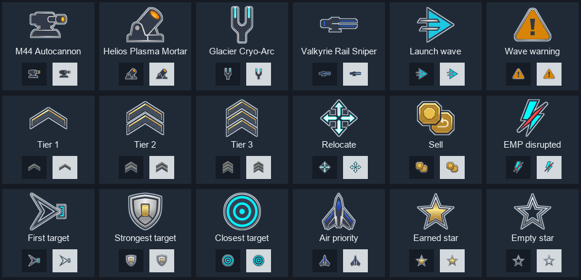
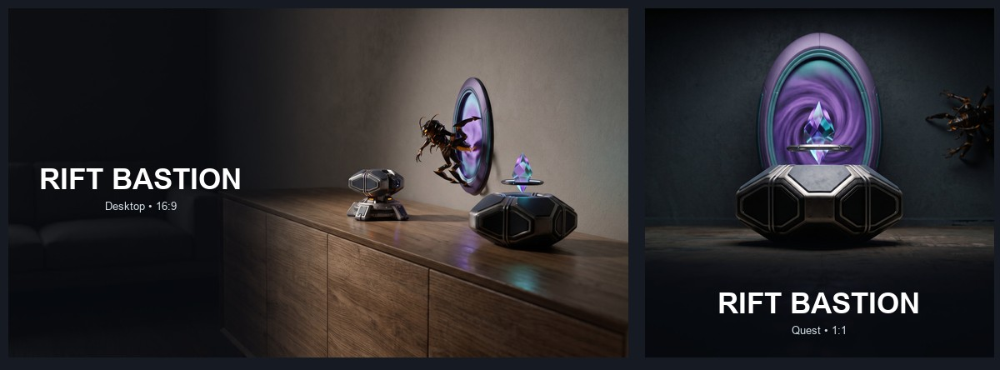
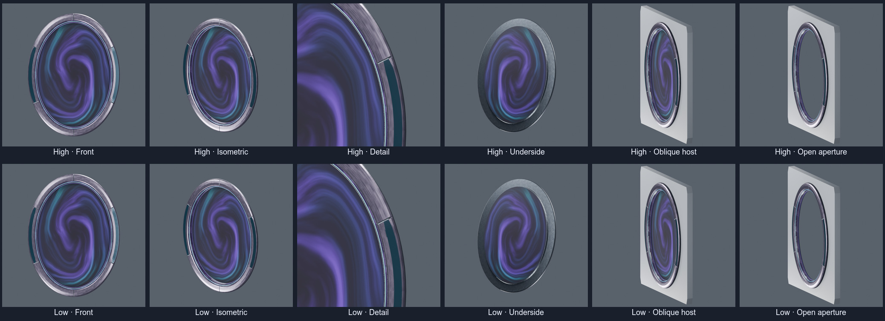
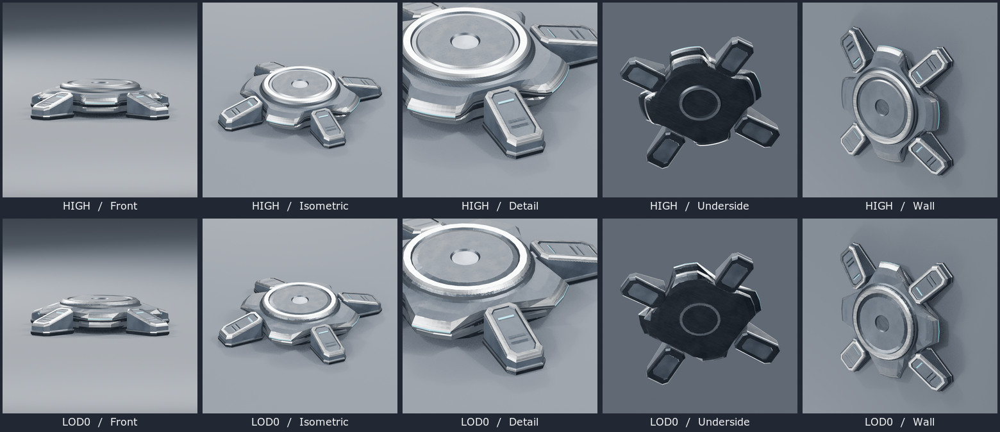
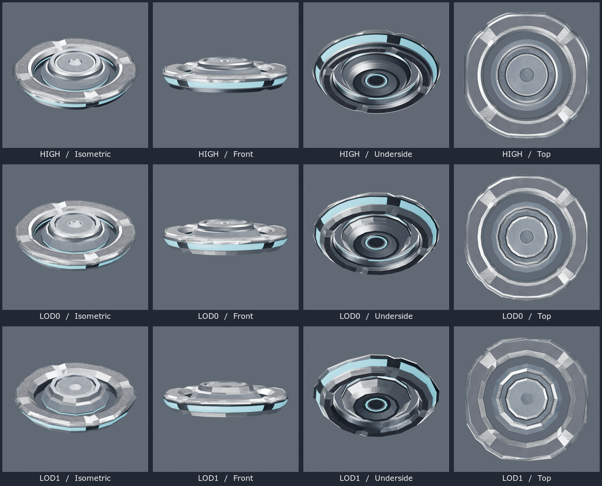
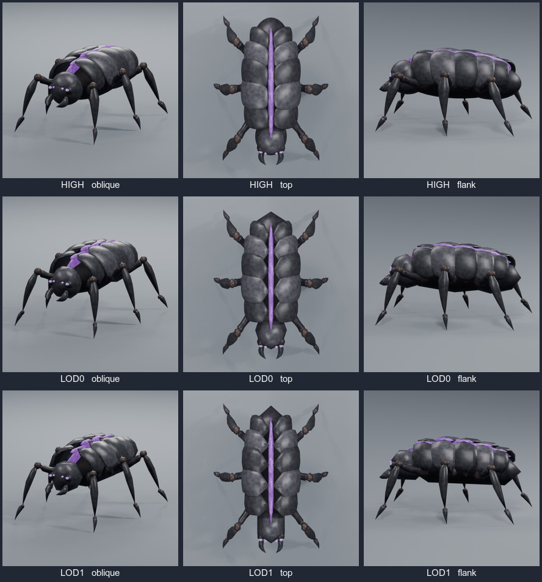
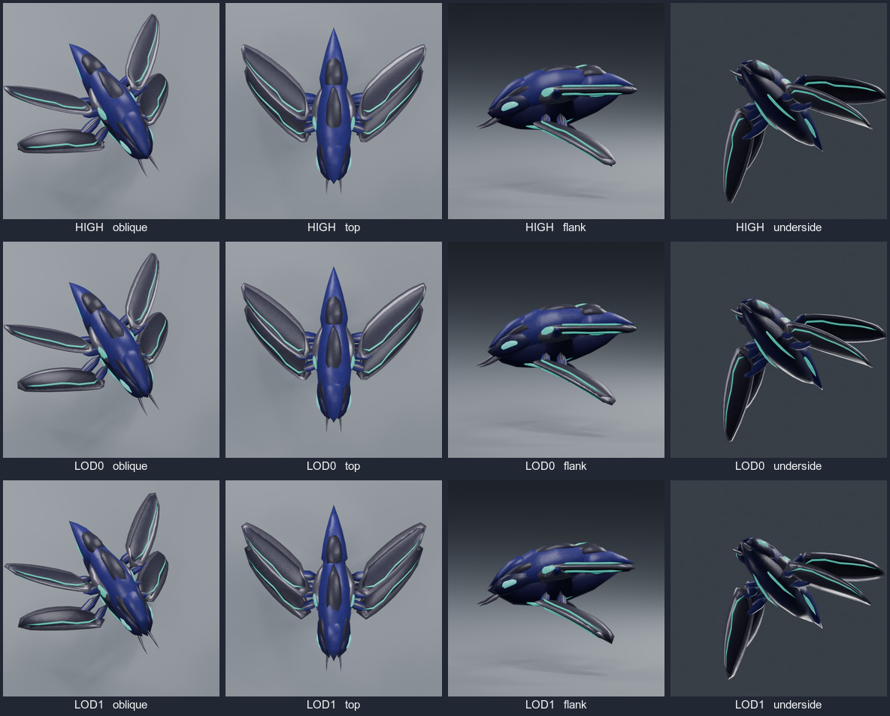
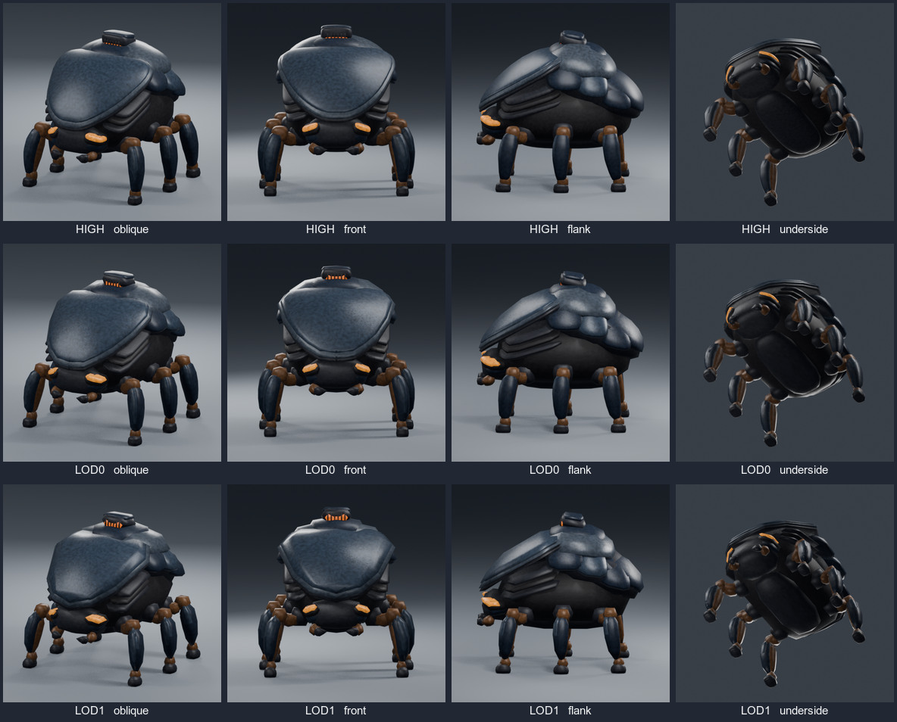

# Rift Bastion art review

## Tactical icons and launch art

**P3-T7 owner sign-off is pending.** This set applies the approved Bastion Rib direction to the Build wheel, Turret Command wheel, mission status, and two launch surfaces. The previews below show the staged files. The game still uses its existing UI until the separately approved integration.

### Menu and status icons



The large samples show shape and finish. The small pair under each name shows the same RGBA file at 24 px over dark and light backgrounds. The M44 uses a short horizontal amber muzzle, Helios a broad angled orange mouth, Glacier an open cyan fork and Valkyrie a long slotted blue rail. The tier chevrons increase in count. A hollow star keeps its center transparent.

The atlas is **768 × 384**, with six 128 px cells per row and transparent gutters. Coordinates are top-left pixel rectangles. Each [individual PNG](../assets-source/ui/candidates/icons/) matches the corresponding [atlas](../assets-source/ui/candidates/tactical-atlas.png) cell byte for byte after decoding. The [atlas metadata](../assets-source/ui/candidates/atlas.json) gives each icon’s immutable sheet and crop rectangle, packed rectangle, desktop actions, radial action IDs, and state-dependent selections.

| Atlas row | Columns from left to right |
| --- | --- |
| 0 | M44, Helios, Glacier, Valkyrie, launch wave, wave warning |
| 1 | Tier 1, tier 2, tier 3, relocate, sell, EMP disrupted |
| 2 | First target, strongest target, closest target, air target, earned star, empty star |

All nine wheel actions have mappings. Upgrade selects the next tier, or the tier 3 icon when capped. Target priority selects the currently active mode. The radial center keeps its existing Cancel/Close behavior. Desktop quick-build keys 1–4 select the matching turret; U, T, R, X and Space use the corresponding command or wave art. [Radial action definitions](../src/xr/radial-controls.ts) · [Desktop controls](../src/desktop/controls.ts)

### Desktop and Quest launch art



The desktop scene places the defense on a living-room sideboard and reserves the shaded sofa wall on the left for type. The Quest card puts the crystal and rift above the title. Both staged JPEGs are text-free. Their safe rectangles are given as left, top, right, bottom pixels, with the last two coordinates exclusive.

| Surface | Candidate | White title safe rectangle | Lowest white-text contrast within rectangle |
| --- | --- | --- | --- |
| Desktop, 16:9 | [1920 × 1080 JPEG](../assets-source/ui/candidates/desktop-title.jpg) | 76, 248, 749, 810 | 15.36:1 |
| Quest, square | [1024 × 1024 JPEG](../assets-source/ui/candidates/quest-title.jpg) | 102, 768, 922, 963 | 17.55:1 |

### Evidence and status

The three Nano Banana Pro sheets contain six icons each. Three background-removal jobs supplied the alpha mattes. The remover dropped disconnected objects on the Build sheet, so the deterministic packer restores missing ink from the corresponding white-background original. Tight crops and two isolation polygons exclude stray reference art. The thin titanium outline keeps the dark silhouettes visible over a dark radial segment. At 24 px, every candidate has at least 18 rendered pixels at 3:1 contrast on each review field. The glyph proof above supports visual inspection alongside that measurement.

Higgsfield billed **15 credits**. That includes one replacement desktop illustration. The first desktop source had a hard vertical seam across the scene. All nine provider originals remain unchanged. The [source manifest](../assets-source/ui/provenance.json) records each prompt, input hash, source hash, settings, job ID, cost, and provider rights references. [SHA-256 inventory](../assets-source/ui/checksums.json)

From a bootstrapped repository root, run these commands to reproduce the 22 candidate files in a temporary directory and check staging against the nine provider sources, references, atlas pixels, title contrast and 27 hashes. The build uses the repository's pinned Biome to format atlas metadata.

```sh
uv run --no-project --python 3.13 --with pillow==12.3.0 python assets-source/ui/build.py --check
uv run --no-project --python 3.13 --with pillow==12.3.0 python assets-source/ui/verify.py
```

The independent P3-T7 score and Paul’s approval remain open. Physical Quest review and live overlay integration belong to the subsequent runtime phase.

## Shared Bastion Rib materials


The Blender 5.2.2 library contains brushed titanium, matte ceramic, dark gunmetal, obsidian chitin and rift obsidian. A fresh build produced the same 16 source PNGs and 16 KTX2 files. Blender export and re-import preserved all five materials and 16 texture bindings. The KTX2 set totals 465,162 bytes. See the [material review and authoring instructions](../assets-source/materials/README.md), [map inventory](../assets-source/materials/manifest.json) and [decoded texture measurements](../assets-source/materials/quality.json). Independent scoring and the owner's release approval remain open at P3-T7.

## Core Bastion


The 6,826-triangle staged Core uses four 2048 px maps. Blender re-import preserved the 0.38 m base radius, 0.72 m visual height, separate shield envelope and emitter animation. The low views use decoded KTX2 textures. See the [Core sources, hashes and re-import checks](../assets-source/models/core-bastion/README.md) and [emitter motion](../assets-source/models/core-bastion/review/emitter-motion.webp). The Core remains staged for independent scoring and owner approval at P3-T7.

## Dimensional Rift Portal



The staged frame is 4,056 triangles and uses five 1024 px maps. The 0.95 × 1.35 m aperture disk shares all 104 boundary positions with the frame. The in-plane rim is 0.12 m wide at both axes. Its 72 mm axial span runs from the −25 mm shader surface to the +47 mm crown and rests against the anchor at Z = 0. The oblique proof uses a synthetic host plane cut to the same ellipse. The current circular runtime stencil and scanned-wall sampling remain Phase 4 verification work. [Rift sources, hashes and re-import checks](../assets-source/models/rift-portal/README.md)

## Surface Clamp Base



The mount has four separate shoes, a 55 mm deck and a 0.15881 m measured radius within the 0.16 m footprint. Both its 2,428-triangle LOD0 and 1,148-triangle LOD1 retain the origin socket, share four 1024 px maps, and preserve contact on all four soles in floor, table and wall fixtures. [Clamp sources, hashes and re-import checks](../assets-source/models/surface-clamp/README.md)

## Repulsor Hover-Ring Pod



The legless pod measures 0.156 m outer radius, 0.145 m emitter radius and 0.070 m height. Its 2,364-triangle LOD0 and 1,148-triangle LOD1 share the origin socket, one material and four 1024 px maps. Both GLBs passed re-import for clearance, shell intersections and the ceramic shoulder's decoded material response. [Hover pod sources, hashes and re-import checks](../assets-source/models/hover-pod/README.md)

## M44 Autocannon

Each head keeps the M44 yaw, pitch, recoil and muzzle transforms, with independent re-import evidence on both mounts. Tier 3 retains six recessed apertures and a separate rotary group. Matched views cover high, LOD0 and LOD1.

| Tier | Head LOD0 / LOD1 triangles | Review |
| --- | ---: | --- |
| T1 single | 2,180 / 788 | [Source, proofs and hashes](../assets-source/models/m44-autocannon-t1/README.md) |
| T2 linked twin | 2,816 / 944 | [Source, proofs and hashes](../assets-source/models/m44-autocannon-t2/README.md) |
| T3 rotary | 3,608 / 1,304 | [Source, proofs and hashes](../assets-source/models/m44-autocannon-t3/README.md) |

The T3 assembly with the larger clamp is 6,036 / 2,452 triangles with two materials. Both clean builds matched all six GLBs and twelve maps byte for byte. The editable archives matched in geometry, UVs, hierarchy, transforms and packed images. Independent scoring and owner approval remain open at P3-T7.

## Helios Plasma Mortar

The staged heads use a single orange chamber at T1, a bridged pair at T2 and broad recessed siege emitters at T3. Re-import verifies the mount origin, neutral muzzle, yaw, pitch and recoil. The 42 EEVEE renders include matched high and low views and both mounts.

| Tier | Head LOD0 / LOD1 triangles | Review |
| --- | ---: | --- |
| T1 single | 2,380 / 876 | [Source, proofs and hashes](../assets-source/models/helios-plasma-mortar-t1/README.md) |
| T2 linked dual | 3,720 / 1,256 | [Source, proofs and hashes](../assets-source/models/helios-plasma-mortar-t2/README.md) |
| T3 siege | 4,024 / 1,352 | [Source, proofs and hashes](../assets-source/models/helios-plasma-mortar-t3/README.md) |

The T3 assembly with the larger clamp is 6,452 / 2,500 triangles and two materials. Each tier uses 1024 px portable maps and an editable high/low Blender pair. These are review candidates for P3-T7.

## Glacier Cryo-Arc

The staged heads progress from a recessed single coil to a fork and a three-pylon conduit around a separate cyan crystal. Re-import verified the neutral muzzle, yaw, pitch, recoil, both mounts and each tier's decoded finish regions. The 42 EEVEE renders include matched high/low and both mounted views.

| Tier | Head LOD0 / LOD1 triangles | Review |
| --- | ---: | --- |
| T1 coil | 2,604 / 1,276 | [Source, proofs and hashes](../assets-source/models/glacier-cryo-arc-t1/README.md) |
| T2 fork | 1,640 / 936 | [Source, proofs and hashes](../assets-source/models/glacier-cryo-arc-t2/README.md) |
| T3 conduit | 2,712 / 1,320 | [Source, proofs and hashes](../assets-source/models/glacier-cryo-arc-t3/README.md) |

The largest assembly measures 5,140 / 2,468 triangles with two materials. LOD1 retains the casing profiles that define the material boundaries. Each tier has four 1024 px maps and an editable Blender pair. The T1 ORM map uses UASTC quality 3 with RDO disabled to preserve the brushed-titanium ambient occlusion sample within the existing tolerance. That map grew by 165,986 bytes. Independent scoring and owner approval remain P3-T7 work.

## Valkyrie Rail Sniper

The compact cobalt rail gains dorsal and ventral capacitor fins at T2 and a pair of open accelerators at T3. All three heads use recessed graphite side panels with a titanium border based on the approved concept. The T3 exported rails leave a clear opening at least 46.64 mm wide over 250 mm beyond the housing. Neutral muzzle pose, yaw, pitch, recoil and moving clearance on both mounts were verified after re-import.

| Tier | Head LOD0 / LOD1 triangles | Review |
| --- | ---: | --- |
| T1 compact rail | 1,164 / 900 | [Source, proofs and hashes](../assets-source/models/valkyrie-rail-sniper-t1/README.md) |
| T2 capacitor fins | 1,444 / 1,180 | [Source, proofs and hashes](../assets-source/models/valkyrie-rail-sniper-t2/README.md) |
| T3 twin accelerators | 1,640 / 1,336 | [Source, proofs and hashes](../assets-source/models/valkyrie-rail-sniper-t3/README.md) |

The largest assembly measures 4,068 / 2,484 triangles and two materials. Each tier uses four 1024 px maps, editable high and low Blender files, and matched high, low and mounted EEVEE views. Independent scoring and owner approval remain P3-T7 work.

## Skitter Crawler



LOD0 measures 0.34 × 0.26 × 0.18 m in its neutral pose and uses 4,340 triangles. LOD1 uses 1,836 triangles and is 1.51 mm shorter. Both use one material, four 1024 px maps and the same 23-bone rig. Each GLB re-import plays `crawl_floor`, `climb_wall`, `attack`, `hit` and `death`. At least three feet contact the support plane at every sampled locomotion pose. The wall fixture rotates the support normal and travel tangent together. Locomotion loops close with zero observed root drift. Attack and hit return to rest, and death holds a collapsed pose.

[Sources, hashes and re-import checks](../assets-source/models/skitter-crawler/README.md) · [Motion poses](../assets-source/models/skitter-crawler/review/motion.jpg) · [Turntable](../assets-source/models/skitter-crawler/review/turntable.mp4). Independent scoring and owner approval remain P3-T7 work.

## Wasp Skimmer



The indigo dart uses four independent swept wings with teal insets and dark undersides. LOD0 measures 0.38 × 0.42 × 0.22 m and uses 5,976 triangles. LOD1 uses 2,116 triangles. Both share one material, four 1024 px maps and nine bones. Each GLB re-import plays `hover_fly`, `bank_turn`, `attack`, `hit` and `death`. Sampled poses preserve the wing gaps and all seven appendage attachments. The revised bank rolls to about 34° while keeping the upper wing roughly 18 mm below the health-bar anchor.

[Sources, hashes and re-import checks](../assets-source/models/wasp-skimmer/README.md) · [Motion poses](../assets-source/models/wasp-skimmer/review/motion.jpg) · [Turntable](../assets-source/models/wasp-skimmer/review/turntable.mp4). Independent scoring and owner approval remain P3-T7 work.

## Carapace Brute



The broad slate shell carries a recessed orange vent, a swept frontal shield and six armored feet. LOD0 uses 8,720 triangles and matches the nominal 0.52 × 0.46 × 0.48 m envelope. LOD1 uses 3,352 triangles. Both share one material, four 1024 px maps and a 24-bone rig. Both GLB re-imports play all five required clips. The brace lowers the shield about 82 mm with all six pads supported and under 0.02 mm of measured pad travel. The stomp alternates groups of three feet. The attack and hit recover to rest, and death holds its collapsed pose.

[Sources, hashes and re-import checks](../assets-source/models/carapace-brute/README.md) · [Motion poses](../assets-source/models/carapace-brute/review/motion.jpg) · [Five-clip reel](../assets-source/models/carapace-brute/review/motion.mp4) · [Turntable](../assets-source/models/carapace-brute/review/turntable.mp4). Independent scoring and owner approval remain P3-T7 work.
