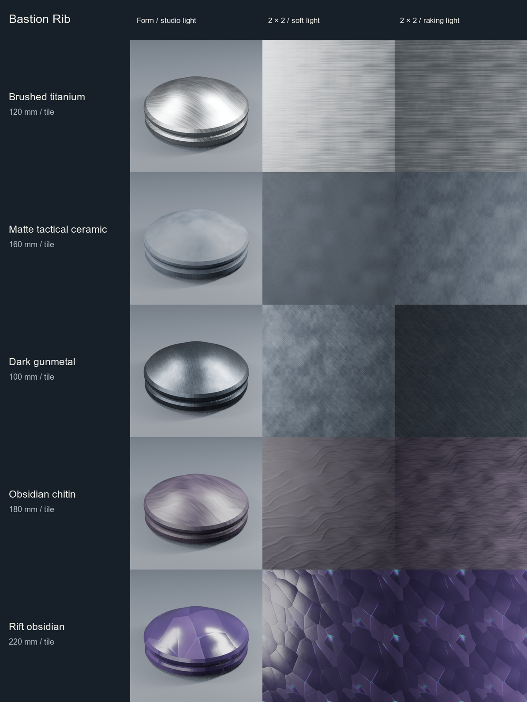
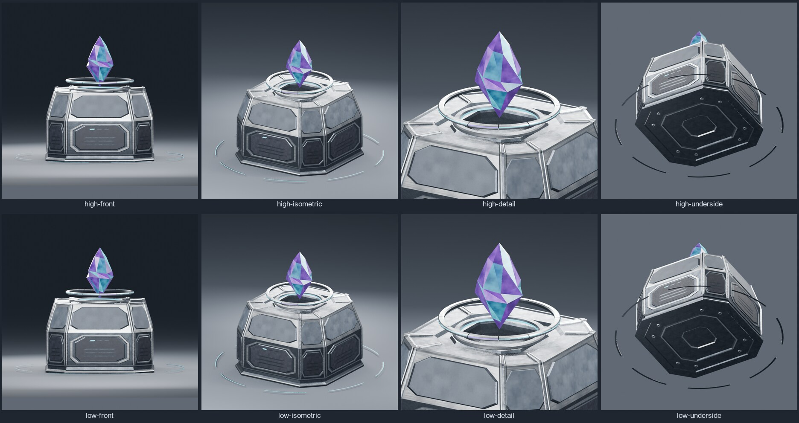
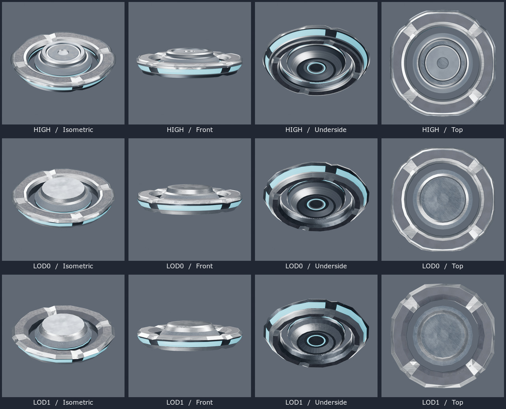
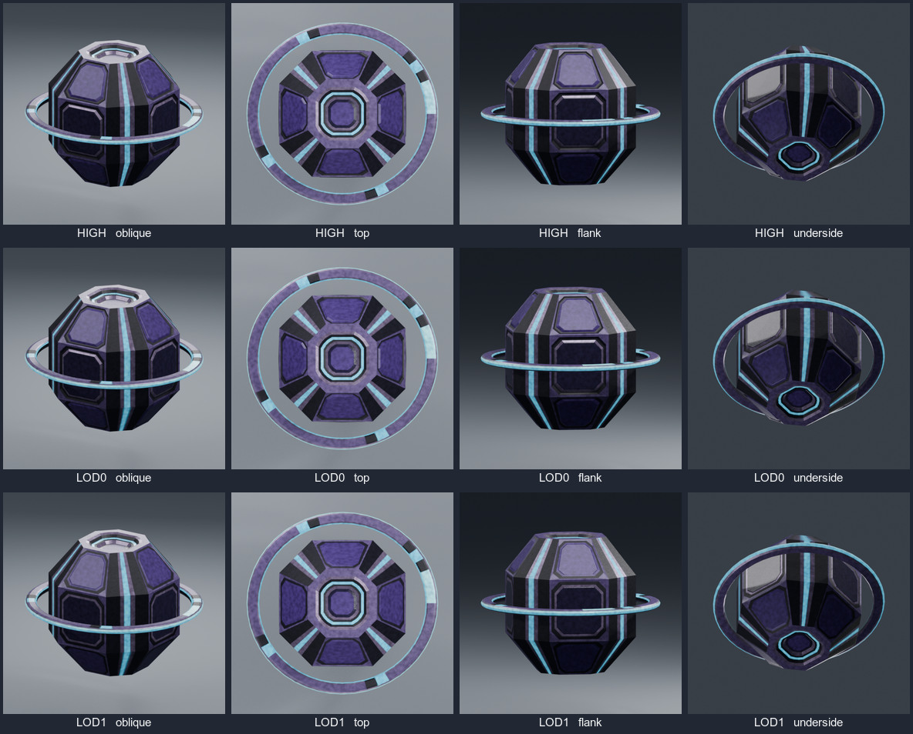
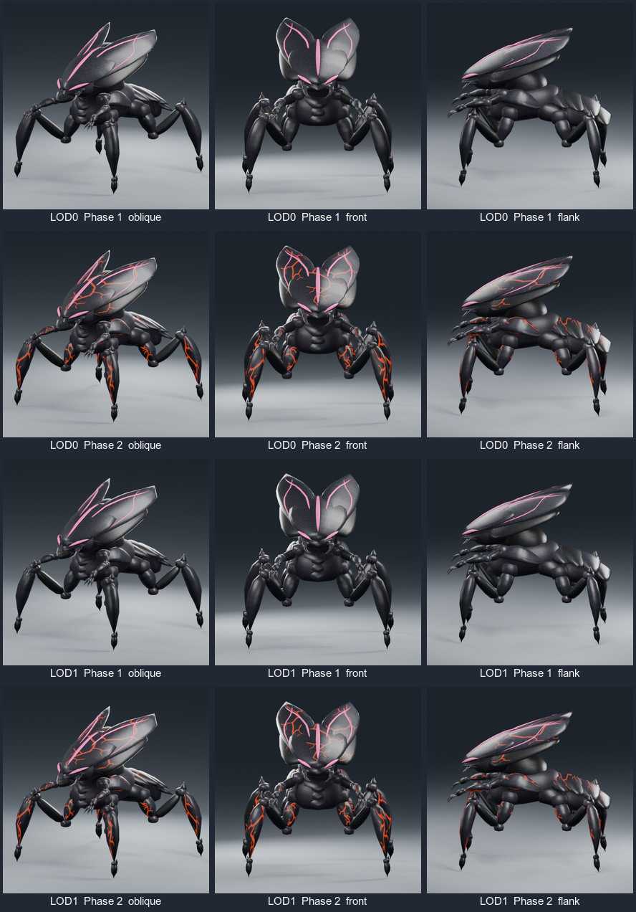

# Rift Bastion art review

See the [initial independent audit](#initial-independent-audit) for the measured budgets, scores and revision findings.

## Tactical icons and launch art

**P3-T7 owner sign-off is pending.** This set applies the approved Bastion Rib direction to the Build wheel, Turret Command wheel, mission status, and two launch surfaces. The previews below show the staged files. The game still uses its existing UI until the separately approved integration.

### Menu and status icons


The large samples show shape and finish. The small pair under each name shows the same RGBA file at 24 px over dark and light backgrounds. The M44 uses a short horizontal amber muzzle, Helios a broad angled orange mouth, Glacier an open cyan fork and Valkyrie a long slotted blue rail. The tier chevrons increase in count. A hollow star keeps its center transparent.

The atlas is **768 × 384**, with six 128 px cells per row and transparent gutters. Coordinates are top-left pixel rectangles. Each [individual PNG](../assets-source/ui/candidates/icons/) matches the corresponding [atlas](../assets-source/ui/candidates/tactical-atlas.png) cell byte for byte after decoding. The [atlas metadata](../assets-source/ui/candidates/atlas.json) gives each icon’s immutable sheet and crop rectangle, packed rectangle, desktop actions, radial action IDs, and state-dependent selections.

| Atlas row | Columns from left to right |
| --- | --- |
| 0 | M44, Helios, Glacier, Valkyrie, launch wave, wave warning |
| 1 | Tier 1, tier 2, tier 3, relocate, sell, EMP disrupted |
| 2 | First target, strongest target, closest target, air target, earned star, empty star |

All nine wheel actions have mappings. Upgrade selects the next tier, or the tier 3 icon when capped. Target priority selects the currently active mode. The radial center keeps its existing Cancel/Close behavior. Desktop quick-build keys 1–4 select the matching turret; U, T, R, X and Space use the corresponding command or wave art. [Radial action definitions](../src/xr/radial-controls.ts) · [Desktop controls](../src/desktop/controls.ts)

### Desktop and Quest launch art


The desktop scene places the defense on a living-room sideboard and reserves the shaded sofa wall on the left for type. The Quest card puts the crystal and rift above the title. Both staged JPEGs are text-free. Their safe rectangles are given as left, top, right, bottom pixels, with the last two coordinates exclusive.

| Surface | Candidate | White title safe rectangle | Lowest white-text contrast within rectangle |
| --- | --- | --- | --- |
| Desktop, 16:9 | [1920 × 1080 JPEG](../assets-source/ui/candidates/desktop-title.jpg) | 76, 248, 749, 810 | 15.36:1 |
| Quest, square | [1024 × 1024 JPEG](../assets-source/ui/candidates/quest-title.jpg) | 102, 768, 922, 963 | 17.55:1 |

### Evidence and status

The three Nano Banana Pro sheets contain six icons each. Three background-removal jobs supplied the alpha mattes. The remover dropped disconnected objects on the Build sheet, so the deterministic packer restores missing ink from the corresponding white-background original. Tight crops and two isolation polygons exclude stray reference art. The thin titanium outline keeps the dark silhouettes visible over a dark radial segment. At 24 px, every candidate has at least 18 rendered pixels at 3:1 contrast on each review field. The glyph proof above supports visual inspection alongside that measurement.

Higgsfield billed **15 credits**. That includes one replacement desktop illustration. The first desktop source had a hard vertical seam across the scene. All nine provider originals remain unchanged. The [source manifest](../assets-source/ui/provenance.json) records each prompt, input hash, source hash, settings, job ID, cost, and provider rights references. [SHA-256 inventory](../assets-source/ui/checksums.json)

From a bootstrapped repository root, run these commands to reproduce the 22 candidate files in a temporary directory and check staging against the nine provider sources, references, atlas pixels, title contrast and 28 hashes. The build uses the repository's pinned Biome to format atlas metadata.

```sh
uv run --no-project --python 3.13 --with pillow==12.3.0 python assets-source/ui/build.py --check
uv run --no-project --python 3.13 --with pillow==12.3.0 python assets-source/ui/verify.py
```

The independent P3-T7 score and Paul’s approval remain open. Physical Quest review and live overlay integration belong to the subsequent runtime phase.

## Shared Bastion Rib materials



The original Blender 5.2.2 library contains brushed titanium, matte ceramic, dark gunmetal, obsidian chitin and rift obsidian. A fresh build produced the same 16 source PNGs and 16 KTX2 files. Blender export and re-import preserved all five materials and 16 texture bindings. The original KTX2 set totals 465,162 bytes. See the [material review and authoring instructions](../assets-source/materials/README.md), [active map inventory](../assets-source/materials/manifest.json) and [original decoded texture measurements](../assets-source/materials/quality.json). Owner approval remains open at P3-T7.

The active inventory uses [the revised Rift obsidian tile](../assets-source/materials/rift-obsidian-revision/README.md). The original library and four original source PNGs remain available to reproduce the staged Rift Portal.

## Core Bastion



The revised 6,858-triangle Core uses four 2048 px maps. Its lower shell tapers inward to four graphite feet that retain the 0.38 m contact radius. Blender re-import preserved the 0.72 m visual height, separate shield envelope and emitter animation. The low views use decoded KTX2 textures. See the [matched revision comparison](../assets-source/models/core-bastion/review/revision-comparison.jpg), [source and re-import checks](../assets-source/models/core-bastion/README.md) and [emitter motion](../assets-source/models/core-bastion/review/emitter-motion.webp).

## Dimensional Rift Portal


The staged frame is 4,056 triangles and uses five 1024 px maps. The 0.95 × 1.35 m aperture disk shares all 104 boundary positions with the frame. The in-plane rim is 0.12 m wide at both axes. Its 72 mm axial span runs from the −25 mm shader surface to the +47 mm crown and rests against the anchor at Z = 0. The oblique proof uses a synthetic host plane cut to the same ellipse. The current circular runtime stencil and scanned-wall sampling remain Phase 4 verification work. [Rift sources, hashes and re-import checks](../assets-source/models/rift-portal/README.md)

## Surface Clamp Base


The mount has four separate shoes, a 55 mm deck and a 0.15881 m measured radius within the 0.16 m footprint. Both its 2,428-triangle LOD0 and 1,148-triangle LOD1 retain the origin socket, share four 1024 px maps, and preserve contact on all four soles in floor, table and wall fixtures. [Clamp sources, hashes and re-import checks](../assets-source/models/surface-clamp/README.md)

## Repulsor Hover-Ring Pod



The revised legless pod preserves its 0.156 m outer radius, 0.145 m emitter radius and 0.070 m height. Its 2,428-triangle LOD0 and 1,132-triangle LOD1 share the identity socket, one material and four 1024 px maps. The curved bowl uses more radial stations and retains its sharp finish boundaries. Both GLBs passed re-import for clearance, shell intersections and the ceramic shoulder's decoded finish. The original mount remains with the turret-head provenance. [Active pod sources, hashes and re-import checks](../assets-source/models/hover-pod-revision/README.md)

At `4f18f1f` the active mount passed all 24 exported head combinations through the family verifiers. The minimum conservative posed clearance was 1.29 mm. Helios T3 was the largest paired assembly at 6,452 / 2,484 triangles on the revised pod. The later Helios T1 revision has its own active-mount verification and preserves the earlier receipt. [Exact compatibility records](../assets-source/models/hover-pod-revision/head-compatibility.json)

## M44 Autocannon

Each head keeps the M44 yaw, pitch, recoil and muzzle transforms, with independent re-import evidence on both mounts. Tier 3 retains six recessed apertures and a separate rotary group. Matched views cover high, LOD0 and LOD1.

| Tier | Head LOD0 / LOD1 triangles | Review |
| --- | ---: | --- |
| T1 single | 2,180 / 788 | [Source, proofs and hashes](../assets-source/models/m44-autocannon-t1/README.md) |
| T2 linked twin | 2,816 / 944 | [Source, proofs and hashes](../assets-source/models/m44-autocannon-t2/README.md) |
| T3 rotary | 3,608 / 1,304 | [Source, proofs and hashes](../assets-source/models/m44-autocannon-t3/README.md) |

The T3 assembly with the larger clamp is 6,036 / 2,452 triangles with two materials. Both clean builds matched all six GLBs and twelve maps byte for byte. The editable archives matched in geometry, UVs, hierarchy, transforms and packed images. Independent scoring and owner approval remain open at P3-T7.

## Helios Plasma Mortar

The staged heads use a single orange chamber at T1, a bridged pair at T2 and broad recessed siege emitters at T3. Re-import verifies the mount origin, neutral muzzle, yaw, pitch and recoil. The 42 EEVEE renders include matched high and low views and both mounts.

| Tier | Head LOD0 / LOD1 triangles | Review |
| --- | ---: | --- |
| T1 single, revised | 3,020 / 1,300 | [Source, proofs and hashes](../assets-source/models/helios-plasma-mortar-t1/README.md) |
| T2 linked dual | 3,720 / 1,256 | [Source, proofs and hashes](../assets-source/models/helios-plasma-mortar-t2/README.md) |
| T3 siege | 4,024 / 1,352 | [Source, proofs and hashes](../assets-source/models/helios-plasma-mortar-t3/README.md) |

The T3 assembly with the larger clamp is 6,452 / 2,500 triangles and two materials. Each tier uses 1024 px portable maps and an editable high/low Blender pair. These are review candidates for P3-T7.

## Glacier Cryo-Arc

The staged heads progress from a recessed single coil to a fork and a three-pylon conduit around a separate cyan crystal. Re-import verified the neutral muzzle, yaw, pitch, recoil, both mounts and each tier's decoded finish regions. The 42 EEVEE renders include matched high/low and both mounted views.

| Tier | Head LOD0 / LOD1 triangles | Review |
| --- | ---: | --- |
| T1 coil | 2,604 / 1,276 | [Source, proofs and hashes](../assets-source/models/glacier-cryo-arc-t1/README.md) |
| T2 fork | 1,640 / 936 | [Source, proofs and hashes](../assets-source/models/glacier-cryo-arc-t2/README.md) |
| T3 conduit | 2,712 / 1,320 | [Source, proofs and hashes](../assets-source/models/glacier-cryo-arc-t3/README.md) |

The largest assembly measures 5,140 / 2,468 triangles with two materials. LOD1 retains the casing profiles that define the material boundaries. Each tier has four 1024 px maps and an editable Blender pair. The T1 ORM map uses UASTC quality 3 with RDO disabled to preserve the brushed-titanium ambient occlusion sample within the existing tolerance. That map grew by 165,986 bytes. Independent scoring and owner approval remain P3-T7 work.

## Valkyrie Rail Sniper

The compact cobalt rail gains dorsal and ventral capacitor fins at T2 and a pair of open accelerators at T3. All three heads use recessed graphite side panels with a titanium border based on the approved concept. The T3 exported rails leave a clear opening at least 46.64 mm wide over 250 mm beyond the housing. Neutral muzzle pose, yaw, pitch, recoil and moving clearance on both mounts were verified after re-import.

| Tier | Head LOD0 / LOD1 triangles | Review |
| --- | ---: | --- |
| T1 compact rail | 1,164 / 900 | [Source, proofs and hashes](../assets-source/models/valkyrie-rail-sniper-t1/README.md) |
| T2 capacitor fins | 1,444 / 1,180 | [Source, proofs and hashes](../assets-source/models/valkyrie-rail-sniper-t2/README.md) |
| T3 twin accelerators | 1,640 / 1,336 | [Source, proofs and hashes](../assets-source/models/valkyrie-rail-sniper-t3/README.md) |

The largest assembly measures 4,068 / 2,484 triangles and two materials. Each tier uses four 1024 px maps, editable high and low Blender files, and matched high, low and mounted EEVEE views. Independent scoring and owner approval remain P3-T7 work.

## Skitter Crawler


LOD0 measures 0.34 × 0.26 × 0.18 m in its neutral pose and uses 4,340 triangles. LOD1 uses 1,836 triangles and is 1.51 mm shorter. Both use one material, four 1024 px maps and the same 23-bone rig. Each GLB re-import plays `crawl_floor`, `climb_wall`, `attack`, `hit` and `death`. At least three feet contact the support plane at every sampled locomotion pose. The wall fixture rotates the support normal and travel tangent together. Locomotion loops close with zero observed root drift. Attack and hit return to rest, and death holds a collapsed pose.

[Sources, hashes and re-import checks](../assets-source/models/skitter-crawler/README.md) · [Motion poses](../assets-source/models/skitter-crawler/review/motion.jpg) · [Turntable](../assets-source/models/skitter-crawler/review/turntable.mp4). Independent scoring and owner approval remain P3-T7 work.

## Wasp Skimmer


The indigo dart uses four independent swept wings with teal insets and dark undersides. LOD0 measures 0.38 × 0.42 × 0.22 m and uses 5,976 triangles. LOD1 uses 2,116 triangles. Both share one material, four 1024 px maps and nine bones. Each GLB re-import plays `hover_fly`, `bank_turn`, `attack`, `hit` and `death`. Sampled poses preserve the wing gaps and all seven appendage attachments. The revised bank rolls to about 34° while keeping the upper wing roughly 18 mm below the health-bar anchor.

[Sources, hashes and re-import checks](../assets-source/models/wasp-skimmer/README.md) · [Motion poses](../assets-source/models/wasp-skimmer/review/motion.jpg) · [Turntable](../assets-source/models/wasp-skimmer/review/turntable.mp4). Independent scoring and owner approval remain P3-T7 work.

## Carapace Brute


The broad slate shell carries a recessed orange vent, a swept frontal shield and six armored feet. LOD0 uses 8,720 triangles and matches the nominal 0.52 × 0.46 × 0.48 m envelope. LOD1 uses 3,352 triangles. Both share one material, four 1024 px maps and a 24-bone rig. Both GLB re-imports play all five required clips. The brace lowers the shield about 82 mm with all six pads supported and under 0.02 mm of measured pad travel. The stomp alternates groups of three feet. The attack and hit recover to rest, and death holds its collapsed pose.

[Sources, hashes and re-import checks](../assets-source/models/carapace-brute/README.md) · [Motion poses](../assets-source/models/carapace-brute/review/motion.jpg) · [Five-clip reel](../assets-source/models/carapace-brute/review/motion.mp4) · [Turntable](../assets-source/models/carapace-brute/review/turntable.mp4). Independent scoring and owner approval remain P3-T7 work.

## Rift Disruptor



The faceted violet hull and luminous equatorial ring are independently rigged. Both LODs preserve the 0.42 × 0.44 × 0.32 m neutral envelope and share one material, three bones and four portable 1024 px maps. LOD0 uses 4,152 triangles and LOD1 uses 2,424. At 320 sampled poses per imported LOD, the hull and ring stayed at least 6 mm apart. Hover completes a full turn, the pulse and hit recover to neutral, and death holds the lowered hull and tilted ring. The revised 184 × 184 polar UV charts preserve the smooth outline in the matched Metal review.

[Sources, hashes and re-import checks](../assets-source/models/rift-disruptor/README.md) · [Polar well comparison](../assets-source/models/rift-disruptor/review/polar-well-comparison.jpg) · [Motion poses](../assets-source/models/rift-disruptor/review/motion.jpg) · [Four-clip reel](../assets-source/models/rift-disruptor/review/motion.mp4) · [Turntable](../assets-source/models/rift-disruptor/review/turntable.mp4). Independent scoring and owner approval remain P3-T7 work.

## Apex Broodlord



The Wave 12 boss has a swept split crest, overlapping obsidian armor, raised claws and four blade legs. LOD0 measures 0.92 × 0.78 × 0.84 m and uses 23,480 triangles. LOD1 uses 7,840 triangles. Both share one material, a 28-bone skeleton and four 2048 px material maps. A separate 2048 px grayscale emissive mask supplies the orange cracks in Phase 2. The matched renderer applies the mask to both imported LODs using the same UVs and leaves the magenta Phase 1 seams visible. Runtime blending belongs to Phase 4.

Both re-imported LODs play `boss_march`, `spawn_adds`, `emp_roar`, `phase2_shift`, `hit` and `death`. The march alternates supporting diagonal pairs. Summon, roar, phase shift and hit recover to rest, and death holds the collapsed pose. The distal crest halves maintain at least 43.5 mm of separation through the sampled movement. The tested interrupted roar-to-hit blend dips 0.62 mm below the support plane. Check that transition in the live mixer in Phase 4.

[Sources, hashes and re-import checks](../assets-source/models/apex-broodlord/README.md) · [Matched geometry views](../assets-source/models/apex-broodlord/review/comparison.jpg) · [Motion poses](../assets-source/models/apex-broodlord/review/motion.jpg) · [Six-clip reel](../assets-source/models/apex-broodlord/review/motion.mp4) · [Turntable](../assets-source/models/apex-broodlord/review/turntable.mp4). Independent scoring and owner approval remain P3-T7 work.

## Initial independent audit

Three reviewers inspected the staged artwork at `ab44c84` against the approved Bastion Rib references. They scored each model for concept and silhouette out of 35, surface craft out of 25, high/low visual consistency out of 25, and readability or motion out of 15. Material reviewers used the same weights for finish, craft, repeats and inspection. The 2D rubric weights purpose at 35, craft at 30, readability or composition at 25, and variant usability at 10.

**35 of 46 passed the 80/100 threshold on the initial candidate.** The eleven findings below must be resolved on revised files and scored independently before the owner checkpoint. These scores describe the frozen revision above.

The initial batch fingerprint is `ab4f4a089e176871a8379387e251673ebd7cc69558db50835429d7b382b2a371`. It includes 796 Git-tracked files under `assets-source/concepts`, `assets-source/materials`, `assets-source/models` and `assets-source/ui`. To reproduce it at that revision, sort the relative path bytes, hash each file, and hash the resulting byte stream with one line per file in the form `<SHA-256><two spaces><relative path><newline>`.

I rechecked 1,730 model source and output hash entries and 27 UI inventory entries. The concept verifier decoded six boards, eleven sheets and three archived attempts with matching hashes. The deterministic UI build reproduced 22 candidates. The pinned Linux gate passed 40 GLBs, 102 KTX2 textures and 218 project tests.

### Model budgets and visual scores

Numbers come from the exported GLB accessors and staged KTX2 mip headers. Materials and bones are the maximum per LOD for each package. KTX2 size counts shared texture files once per model. The RGBA8 mip estimate gives the uncompressed capacity for these maps. Live Quest texture formats, residency and frame timing are measured in Phase 5.

| Model and provenance | Triangles LOD0 / LOD1 | Bones | Materials | Maps | KTX2 / RGBA8 mip MiB | Visual |
| --- | ---: | ---: | ---: | --- | ---: | ---: |
| [Core Bastion](../assets-source/models/core-bastion/provenance.json) | 6,826 / — | 0 | 3 | 4 × 2048 px | 4.35 / 85.33 | **78** |
| [Dimensional Rift Portal](../assets-source/models/rift-portal/provenance.json) | 4,056 / — | 0 | 2 | 5 × 1024 px | 1.76 / 26.67 | 89 |
| [Surface Clamp Base](../assets-source/models/surface-clamp/provenance.json) | 2,428 / 1,148 | 0 | 1 | 4 × 1024 px | 1.70 / 21.33 | 88 |
| [Repulsor Hover-Ring Pod](../assets-source/models/hover-pod/provenance.json) | 2,364 / 1,148 | 0 | 1 | 4 × 1024 px | 1.54 / 21.33 | **78** |
| [M44 Autocannon T1](../assets-source/models/m44-autocannon-t1/provenance.json) | 2,180 / 788 | 0 | 1 | 4 × 1024 px | 1.68 / 21.33 | 83 |
| [M44 Autocannon T2](../assets-source/models/m44-autocannon-t2/provenance.json) | 2,816 / 944 | 0 | 1 | 4 × 1024 px | 1.71 / 21.33 | 82 |
| [M44 Autocannon T3](../assets-source/models/m44-autocannon-t3/provenance.json) | 3,608 / 1,304 | 0 | 1 | 4 × 1024 px | 1.99 / 21.33 | 81 |
| [Helios Plasma Mortar T1](../assets-source/models/helios-plasma-mortar-t1/provenance.json) | 2,380 / 876 | 0 | 1 | 4 × 1024 px | 1.84 / 21.33 | **76** |
| [Helios Plasma Mortar T2](../assets-source/models/helios-plasma-mortar-t2/provenance.json) | 3,720 / 1,256 | 0 | 1 | 4 × 1024 px | 2.00 / 21.33 | 80 |
| [Helios Plasma Mortar T3](../assets-source/models/helios-plasma-mortar-t3/provenance.json) | 4,024 / 1,352 | 0 | 1 | 4 × 1024 px | 2.02 / 21.33 | 82 |
| [Glacier Cryo-Arc T1](../assets-source/models/glacier-cryo-arc-t1/provenance.json) | 2,604 / 1,276 | 0 | 1 | 4 × 1024 px | 1.90 / 21.33 | 83 |
| [Glacier Cryo-Arc T2](../assets-source/models/glacier-cryo-arc-t2/provenance.json) | 1,640 / 936 | 0 | 1 | 4 × 1024 px | 1.77 / 21.33 | **75** |
| [Glacier Cryo-Arc T3](../assets-source/models/glacier-cryo-arc-t3/provenance.json) | 2,712 / 1,320 | 0 | 1 | 4 × 1024 px | 1.80 / 21.33 | 84 |
| [Valkyrie Rail Sniper T1](../assets-source/models/valkyrie-rail-sniper-t1/provenance.json) | 1,164 / 900 | 0 | 1 | 4 × 1024 px | 1.74 / 21.33 | 82 |
| [Valkyrie Rail Sniper T2](../assets-source/models/valkyrie-rail-sniper-t2/provenance.json) | 1,444 / 1,180 | 0 | 1 | 4 × 1024 px | 1.80 / 21.33 | 85 |
| [Valkyrie Rail Sniper T3](../assets-source/models/valkyrie-rail-sniper-t3/provenance.json) | 1,640 / 1,336 | 0 | 1 | 4 × 1024 px | 1.79 / 21.33 | 83 |
| [Skitter Crawler](../assets-source/models/skitter-crawler/provenance.json) | 4,340 / 1,836 | 23 | 1 | 4 × 1024 px | 2.29 / 21.33 | **77** |
| [Wasp Skimmer](../assets-source/models/wasp-skimmer/provenance.json) | 5,976 / 2,116 | 9 | 1 | 4 × 1024 px | 2.30 / 21.33 | **77** |
| [Carapace Brute](../assets-source/models/carapace-brute/provenance.json) | 8,720 / 3,352 | 24 | 1 | 4 × 1024 px | 2.30 / 21.33 | **79** |
| [Rift Disruptor](../assets-source/models/rift-disruptor/provenance.json) | 4,152 / 2,424 | 3 | 1 | 4 × 1024 px | 1.74 / 21.33 | 86 |
| [Apex Broodlord](../assets-source/models/apex-broodlord/provenance.json) | 23,480 / 7,840 | 28 | 1 | 5 × 2048 px | 7.19 / 106.67 | **75** |

### Materials and visual scores

| Finish and repeat proof | Maps | KTX2 / RGBA8 mip MiB | Visual |
| --- | --- | ---: | ---: |
| [Brushed titanium](../assets-source/materials/review/brushed-titanium.webp) | 3 × 256 px | 0.08 / 1.00 | 91 |
| [Tactical ceramic](../assets-source/materials/review/tactical-ceramic.webp) | 3 × 256 px | 0.10 / 1.00 | 87 |
| [Dark gunmetal](../assets-source/materials/review/dark-gunmetal.webp) | 3 × 256 px | 0.09 / 1.00 | 88 |
| [Obsidian chitin](../assets-source/materials/review/obsidian-chitin.webp) | 3 × 256 px | 0.08 / 1.00 | 82 |
| [Rift obsidian](../assets-source/materials/review/rift-obsidian.webp) | 4 × 256 px | 0.10 / 1.33 | **78** |

### Tactical badges and launch artwork scores

The 18 badges are 128 × 128 RGBA proof files in a 768 × 384 atlas. Reviewers compared the actual 24 px composites on both fields. The launch artwork was reviewed with its title-safe overlay.

| Asset | Visual |
| --- | ---: |
| [Build M44](../assets-source/ui/candidates/icons/build-autocannon.png) | 83 |
| [Build Helios](../assets-source/ui/candidates/icons/build-plasma-mortar.png) | 93 |
| [Build Glacier](../assets-source/ui/candidates/icons/build-cryo-arc.png) | 91 |
| [Build Valkyrie](../assets-source/ui/candidates/icons/build-rail-sniper.png) | **73** |
| [Launch wave](../assets-source/ui/candidates/icons/wave-launch.png) | 92 |
| [Wave warning](../assets-source/ui/candidates/icons/wave-warning.png) | 97 |
| [Tier 1](../assets-source/ui/candidates/icons/tier-1.png) | 92 |
| [Tier 2](../assets-source/ui/candidates/icons/tier-2.png) | 90 |
| [Tier 3](../assets-source/ui/candidates/icons/tier-3.png) | 87 |
| [Relocate](../assets-source/ui/candidates/icons/relocate.png) | 89 |
| [Sell](../assets-source/ui/candidates/icons/sell.png) | 89 |
| [EMP disrupted](../assets-source/ui/candidates/icons/emp-disrupted.png) | 86 |
| [Target first](../assets-source/ui/candidates/icons/target-first.png) | **77** |
| [Target strongest](../assets-source/ui/candidates/icons/target-strongest.png) | 88 |
| [Target closest](../assets-source/ui/candidates/icons/target-closest.png) | 96 |
| [Target air](../assets-source/ui/candidates/icons/target-air.png) | 89 |
| [Earned star](../assets-source/ui/candidates/icons/star-earned.png) | 97 |
| [Empty star](../assets-source/ui/candidates/icons/star-empty.png) | 91 |
| [Desktop launch art, 1920 × 1080](../assets-source/ui/candidates/desktop-title.jpg) | 95 |
| [Quest launch art, 1024 × 1024](../assets-source/ui/candidates/quest-title.jpg) | 86 |

### Findings requiring revision

| Finding | Asset | Initial score | Observed issue and revision |
| --- | --- | ---: | --- |
| F1 | Valkyrie icon | 73 | The long dark silhouette collapses into a bar at 24 px. Thicken the silhouette and cobalt bands and open the rail slot. |
| F2 | First-target icon | 77 | The tiny finish marker leaves a dominant arrow that competes with Launch Wave. Use a separated, stronger finish post with a shorter arrow. |
| F3 | Rift obsidian | 78 | One bright cyan junction repeats on a visible square grid under both light angles. Vary the spacing and brightness of the inclusions. |
| F4 | Core Bastion | 78 | The light, straight-sided pedestal loses the reference's recessed lower body. Taper the underside, darken the ceramic and retain brighter ribs. |
| F5 | Hover Pod | 78 | The low underside reads as stacked angular bands with alternating bright faces. Smooth its shading and preserve more continuity in its largest rings. |
| F6 | Helios T1 | 76 | The low chamber reads as a flat peach disk and the shell shows triangular highlights. Restore the recessed center and smooth the broad shell. |
| F7 | Glacier T2 | 75 | The mounted fork reads as two short capped posts. Lengthen the projecting blades and extend cyan along the facing channels. |
| F8 | Skitter Crawler | 77 | Uniform rounded plates and exposed knee balls simplify the anatomy. Vary the overlapping scutes, cover the limb joints and preserve taper at LOD1. |
| F9 | Wasp Skimmer | 77 | Thin pointed wings, exposed spars and a stray teal LOD1 patch weaken the silhouette. Broaden the wing panels, restore the layered nose and fix dorsal color bleed. |
| F10 | Carapace Brute | 79 | The shield is one rounded face, the vent is a small cap and the pads read as buttons. Restore stepped shield planes, expose more vent and broaden the armored shins and pads. |
| F11 | Apex Broodlord | 75 | The frontal crest reads as separate upright paddles above round eyes. Broaden the crest root, add an angular brow and hooked jaws, and overlap the abdominal armor while retaining the split tips. |

## Passed revisions

Forty-one of 46 assets have independent visual scores of at least 80. The thirty-five passing assets from the first audit and the following six revised assets account for those results. The remaining findings are F7–F11.

| Finding | Asset | Initial → revised | Exact proof and result |
| --- | --- | ---: | --- |
| F1 | Valkyrie icon | 73 → 87 | [Native 24 px comparison](../assets-source/ui/review/badge-revision.png) and [revised icon](../assets-source/ui/candidates/icons/build-rail-sniper.png). Two cobalt rails and their slot remain visible on both fields. The rail PNG SHA-256 begins `458126da10ba`. |
| F2 | First-target icon | 77 → 87 | [Native 24 px comparison](../assets-source/ui/review/badge-revision.png) and [revised icon](../assets-source/ui/candidates/icons/target-first.png). The chevron and cyan finish post stay separate beside Launch Wave. The final target PNG SHA-256 begins `b4330bd1a0f5`. |
| F3 | Rift obsidian | 78 → 86 | [Revised coupon and 2×2 repeats](../assets-source/materials/rift-obsidian-revision/review/rift-obsidian.webp) and [revision provenance](../assets-source/materials/rift-obsidian-revision/provenance.json). The irregular cyan inclusions remove the bright grid in both matched light angles. The reviewer still observed subtle dark repetition under raking light. |
| F4 | Core Bastion | 78 → 86 | [Matched revision views](../assets-source/models/core-bastion/review/revision-comparison.jpg). The dark belly tapers below the waist, and all four attached feet support the recessed base. The pointed feet and broad pale crown remain more prominent than in the concept. The exact revised GLB SHA-256 is `564ee6bc93f7fafcc12129acb95081208a1db7c51c7f9035a017bef8a99e7c05`. |
| F5 | Hover Pod | 78 → 81 | [Matched underside revision](../assets-source/models/hover-pod-revision/review/underside-comparison.jpg). The bowl carries a continuous highlight and the cyan optic remains round at LOD1. The outer rim remains angular and the imported top cap has less detail. The reviewed LOD0 and LOD1 GLB hashes begin `db15e31bd646` and `c6c39de56241`. |
| F6 | Helios T1 | 76 → 83 | [Matched revision](../assets-source/models/helios-plasma-mortar-t1/review/revision-comparison.jpg). The dark chamber and smaller bright center read at both LODs. The rear highlight is smoother, with some mottling on the low shoulder and polygon corners on its pivot cap. The reviewed GLB hashes begin `bd90a619` and `acb97ddf`. |

The exact badge proof SHA-256 is `608eea9914f08dc20961df864f55e6ae8d59e4fdd015a4dd0fe7fba348310911`. The exact revised obsidian proof SHA-256 is `5ddcceed74d963da9662c547d41dfcf7a50b9300f7a5f24af0476dc8c89b7f44`.
